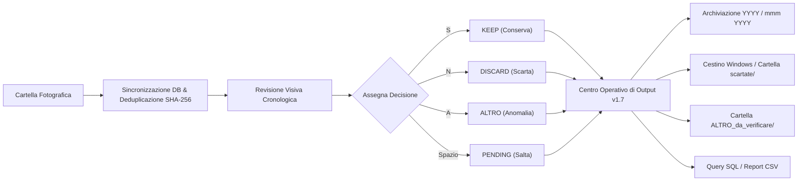

# Foto_Review v1.7

Foto_Review è un'applicazione desktop professionale per Windows concepita per revisionare archivi
fotografici complessi o disorganizzati, assegnare una classificazione rapida ad ogni immagine e
organizzare o ripulire i file selezionati con la massima trasparenza e tracciabilità.

L'applicazione opera direttamente sui file della cartella di lavoro selezionata:
le operazioni di output spostano o cestinano gli elementi originali, evitando duplicazioni
inutili di spazio su disco.

---

## Indice

- [Novità della Versione 1.7](#novità-della-versione-17)
- [Novità della Versione 1.6](#novità-della-versione-16)
- [Funzionamento in Breve](#funzionamento-in-breve)
- [Avvio e Requisiti](#avvio-e-requisiti)
- [Fase 1: Revisione Visiva e Classificazione](#fase-1-revisione-visiva-e-classificazione)
  - [Interfaccia Grafica Principale](#interfaccia-grafica-principale)
  - [Decisioni e Scorciatoie da Tastiera](#decisioni-e-scorciatoie-da-tastiera)
  - [Viewer Responsive e Rotazione](#viewer-responsive-e-rotazione)
  - [Scheda Metadati, Cronologia e Dettagli](#scheda-metadati-cronologia-e-dettagli)
  - [Navigazione, Salto Rapido e Ripresa Sessione](#navigazione-salto-rapido-e-ripresa-sessione)
- [Fase 2: Centro Operativo di Output & Smistamento](#fase-2-centro-operativo-di-output--smistamento)
  - [Dashboard Metriche Live e Modalità Simulazione](#dashboard-metriche-live-e-modalità-simulazione)
  - [Gruppo A: Azioni sui File Esaminati (KEEP / DISCARD / ALTRO)](#gruppo-a-azioni-sui-file-esaminati-keep--discard--altro)
  - [Gruppo B: Gestione File Non Esaminati (PENDING)](#gruppo-b-gestione-file-non-esaminati-pending)
  - [Gruppo C: Query SQL Libera, Preset e Anteprima Integrata](#gruppo-c-query-sql-libera-preset-e-anteprima-integrata)
  - [Gruppo D: Report CSV, Duplicati, Log e Manutenzione](#gruppo-d-report-csv-duplicati-log-e-manutenzione)
- [Deduplicazione Automatica (Duplicati Certi)](#deduplicazione-automatica-duplicati-certi)
- [Database SQLite e Tracciabilità](#database-sqlite-e-tracciabilità)
- [Struttura dei Moduli](#struttura-dei-moduli)

---

## Novità della Versione 1.7

La versione 1.7 perfeziona ulteriormente l'esperienza d'uso e le prestazioni del programma, risolvendo le criticità emerse nei test operativi su grandi collezioni di immagini:

1. **Tema Moderno Royal Blue (Eliminazione linee nere e header cupi):**
   - Sostituzione integrale delle linee nere cupe e degli header scuri con una palette moderna e luminosa basata sul **Royal Blue** (`#1e40af`, `#2563eb`, `#3b82f6`, `#dbeafe`).
   - Gli header principali (barra superiore, sidebar e finestra Centro Output) adottano ora una finitura blu coordinata ed elegante.
   - Tutti i bordi e divisori utilizzano evidenziature perimetrali morbide (`highlightbackground="#93c5fd"` / `#bfdbfe`) eliminando i bordi neri rigidi predefiniti di Tkinter.
2. **Scansione Multithread e Barra di Avanzamento Reattiva:**
   - La sincronizzazione della cartella e il calcolo crittografico SHA-256 / EXIF avvengono ora in background su thread paralleli (`concurrent.futures.ThreadPoolExecutor`), sfruttando tutti i core della CPU.
   - Eliminato definitivamente il congelamento dell'interfaccia grafica e la dicitura di Windows *"Non risponde"* durante l'analisi di cartelle con centinaia o migliaia di foto.
   - Finestra modale di caricamento reattiva in tempo reale (`LoadingProgressDialog`) con barra di progresso, percentuale e contatore file aggiornati a 60 fps tramite dispacciamento asincrono Tkinter (`root.after`).
3. **Sfondi Decisione Più Saturi e Bordo Sensoriale a 4 Pixel:**
   - Sfondi decisionali ricalibrati con tonalità nettamente più sature e riconoscibili al colpo d'occhio (`#86efac` KEEP, `#fca5a5` DISCARD, `#fde047` ALTRO, `#cbd5e1` PENDING).
   - Introduzione di una **cornice sensoriale perimetrale spessa 4 pixel** attorno al viewer fotografico (`#15803d` KEEP, `#dc2626` DISCARD, `#d97706` ALTRO, `#2563eb` PENDING): garantisce un feedback visivo istantaneo anche quando l'immagine riempie completamente la tela nascondendo lo sfondo.
4. **Protezione Completa contro Sovrapposizione di Stringhe:**
   - Pre-cancellazione esplicita del testo dei widget prima di ogni aggiornamento per prevenire artefatti grafici o testo residuo sovrapposto.
   - Troncamento intelligente dei percorsi cartella lunghi (`shorten_path`), visualizzando la radice e l'ultima sottocartella senza invadere i pulsanti adiacenti.
   - Inversione dell'ordine di packing (`pack(side=tk.RIGHT)` prima delle label espandibili) e `wraplength` reattivo per nomi di file lunghi e hash SHA-256.
   - Pulizia totale della tela (`canvas.delete("all")`) prima di ogni rendering.

---

## Novità della Versione 1.6

La versione 1.6 introduce un'esperienza d'uso rinnovata, moderna, ergonomica e autoesplicativa:

1. **Interfaccia Grafica Moderna ad Alto Contrasto (Palette Slate Modern):**
   - Header superiore scuro elegante con accesso rapido alla selezione cartelle, al Centro Output e alla guida tasti.
   - Schede bianche su sfondo neutro chiaro con bordi rifiniti e chiara gerarchia visiva.
   - Supporto DPI Awareness nativo su Windows per testo, controlli e pulsanti sempre nitidi su qualsiasi risoluzione/monitor.
2. **Viewer Fotografico Responsive Adattivo:**
   - La canvas di visualizzazione ridimensiona dinamicamente le foto in tempo reale adattandosi a qualsiasi dimensione o massimizzazione della finestra, con ricampionamento di alta qualità Lanczos e debouncing anti-sfarfallio.
   - Bordo e sfondo dinamici armonizzati con lo stato della foto.
   - Badge di stato visivo prominente (`✓ KEEP`, `✕ DISCARD`, `⚠ ALTRO`, `⏳ PENDING`) con data/ora in cui la decisione è stata presa.
3. **Pannello di Controllo & Progresso in Tempo Reale:**
   - Barra di avanzamento grafica (`ttk.Progressbar`) con percentuale live di completamento dell'archivio.
   - Chip riassuntive sempre visibili con i conteggi esatti per ogni categoria.
   - Casella **Vai a foto #** per saltare istantaneamente a qualsiasi immagine numerica nell'archivio.
4. **Completamento della Classificazione: Decisione Diretta `ALTRO` [A]:**
   - Ora l'operatore può assegnare manualmente lo stato `ALTRO` tramite pulsante dedicato o tasto rapido `A` (utile per screenshot, ricevute, documenti personali o file da verificare separatamente).
5. **Scheda Metadati Strutturata:**
   - Riorganizzata in quattro sezioni distinte: **Proprietà File** (con pulsanti per copiare nome file e hash SHA-256), **Cronologia & Origine Data**, **Fotocamera & Scatto** (tempo, diaframma, ISO, focale) e **Tutti i Metadati EXIF**.
6. **Finestra Aiuto Scorciatoie da Tastiera [F1]:**
   - Finestra modale accessibile con il tasto `F1` o dal menu per consultare in qualsiasi momento la tabella completa dei comandi.
7. **Centro Operativo di Output v1.6 Potenziato:**
   - Formato widescreen scrollabile con rotellina del mouse.
   - Dashboard a 7 tessere metriche live.
   - Banner visivo di sicurezza per la modalità Simulazione (Dry-run).
   - **12 Preset di Query SQL pronte all'uso** a selezione rapida (per anno, per dimensione, foto WhatsApp, senza EXIF, ecc.).
   - **Riquadro di Anteprima Query SQL integrato**, con elenco dettagliato dei file corrispondenti (nome, dimensione, data, stato) prima dell'esecuzione fisica.
   - Pulsanti per aprire direttamente la cartella di lavoro, i report CSV esportati e il log `output_log.txt`.

---

## Funzionamento in Breve



1. **Selezione:** Si seleziona una cartella di lavoro contenente le immagini.
2. **Deduplicazione immediata:** I file identici (stesso SHA-256 e dimensione) vengono isolati automaticamente in `duplicati certi/` lasciando un solo originale in radice.
3. **Revisione cronologica:** Le foto vengono presentate in ordine temporale con data calcolata, parametri di scatto e anteprima responsive.
4. **Valutazione:** Si assegna a ciascuna foto `KEEP` [S], `DISCARD` [N], `ALTRO` [A] o la si lascia `PENDING` [Spazio]. In caso di errore, `Ctrl+Z` annulla l'ultima decisione.
5. **Output e Smistamento:** Dal **Centro Output** si eseguono le azioni massive: archiviazione per cartelle d'anno o mese, cestinatura sicura, isolamento delle anomalie o esportazione dei report.

---

## Avvio e Requisiti

- **Ambiente:** Python 3.8+ su Windows 10 / 11.
- **Dipendenze principali:** `Pillow` (PIL) per l'elaborazione immagini, `send2trash` per la cestinatura sicura nel Cestino di Windows.
- **Avvio:**
  ```powershell
  python main.py
  ```
- **File di lavoro creati nella cartella selezionata:**
  - `photo_reviews.db`: database SQLite locale con cronologia, hash e decisioni.
  - `.photo_review_session.json`: file di ripresa per ripartire esattamente dall'ultima foto esaminata.
  - `output_log.txt`: registro cronologico di tutte le azioni di output effettuate.

---

## Fase 1: Revisione Visiva e Classificazione

### Interfaccia Grafica Principale

La schermata principale è suddivisa in aree funzionali coordinate:

1. **Barra Superiore (Header Bar):**
   - Logo e versione `📸 Foto Review 1.7`.
   - Pulsante **Seleziona Cartella Foto** (con percorso visualizzato).
   - Pulsanti rapidi per aprire il **Centro Output**, visualizzare le **Scorciatoie [F1]** o uscire.
2. **Pannello di Controllo & Progresso (Dashboard):**
   - Indicatore del percorso cartella corrente.
   - Chip colorate con conteggio in tempo reale delle foto: `✓ KEEP`, `✕ DISCARD`, `⚠ ALTRO`, `⏳ PENDING`.
   - Barra di progresso grafica percentuale: `Foto X di Y | Valutate: N/Totale (%)`.
   - Salto rapido numerico: casella `Vai a foto #` con pulsante **Vai** (o tasto Invio).
3. **Area Centrale (Viewer + Sidebar):**
   - A sinistra: grande riquadro anteprima responsive con badge di stato decisionale, indicatore rotazione e controlli `↺ -90°` e `↻ +90°`.
   - A destra: sidebar con informazioni strutturate sul file, data cronologica, modello di fotocamera, impostazioni di scatto e metadati EXIF completi.
4. **Barra dei Controlli Inferiore:**
   - Navigazione: `|◀ Inizio`, `◀◀ -10`, `▲ Prec [↑]`, `Succ [↓] ▼`, `+10 ▶▶`, `Fine ▶|`.
   - Azioni: `✕ SCARTA [N]`, `⚠ ALTRO [A]`, `⏭ SALTA [Spazio]`, `✓ CONSERVA [S]`, `↩ Annulla [Ctrl+Z]`.
5. **Barra di Stato (Footer):**
   - Descrizione testuale dell'ultima azione eseguita e stato di connessione al database.

### Decisioni e Scorciatoie da Tastiera

| Decisione | Significato | Pulsante | Scorciatoia |
|---|---|---|---|
| `KEEP` | Foto approvata da conservare e archiviare | Verde **Conserva** | `S` oppure `s` |
| `DISCARD` | Foto scartata da eliminare o spostare | Rosso **Scarta** | `N` oppure `n` |
| `ALTRO` | File anomalo, corrotto, screenshot o da verificare | Giallo/Ambra **Altro** | `A` oppure `a` |
| `PENDING` | Lascia la foto in attesa senza prendere decisioni | Grigio **Salta** | Barra Spaziatrice |
| `UNDO` | Annulla l'ultima decisione e ritorna a quel file | Arancione **Annulla** | `Ctrl + Z` |

#### Comandi di Navigazione e Vista

- **Freccia Su / Giù:** Foto precedente / successiva (±1).
- **Ctrl + Freccia Su / Giù:** Salto indietro / avanti di 10 foto (±10).
- **Page Up / Page Down:** Salto indietro / avanti di 100 foto (±100).
- **Home / End:** Vai direttamente alla prima / ultima foto dell'archivio.
- **Freccia Sinistra / Destra:** Ruota temporaneamente l'anteprima a schermo di 90° in senso antiorario o orario (non altera il file su disco).
- **F1:** Apre la finestra interattiva di riepilogo comandi.
- **Ctrl + O:** Apre direttamente il Centro Operativo di Output.

### Viewer Responsive e Rotazione

A differenza delle versioni precedenti in cui l'immagine aveva dimensioni fisse a 700x500 pixel, in **v1.6** la canvas è interamente **responsive**:
- Ridimensionando o massimizzando la finestra su monitor Full HD, 2K o 4K, l'anteprima fotografica ricalcola proporzioni e dimensioni massime occupando tutto lo spazio a disposizione con filtro ad alta fedeltà `LANCZOS`.
- Un temporizzatore di debouncing impedisce blocchi o cali di fluidità durante il trascinamento dei bordi della finestra.
- Se il file è corrotto, a 0 byte o non leggibile, viene mostrato un avviso grafico evidente indicando che il file è classificato come `ALTRO`.

### Scheda Metadati, Cronologia e Dettagli

La colonna laterale destra mostra in tempo reale:
1. **Proprietà File:**
   - Nome del file (con pulsante copia negli appunti).
   - Dimensione leggibile formattata (es. `3.42 MB`).
   - Risoluzione effettiva in pixel e Megapixel (es. `4032 × 3024 px • 12.2 MP`).
   - Checksum crittografico SHA-256 (con pulsante rapido di copia).
2. **Cronologia & Origine Data:**
   - Data temporale calcolata per l'ordinamento cronologico.
   - Origine della data: metadati nativi `EXIF DateTimeOriginal`, pattern data nel nome del file (es. WhatsApp `IMG-YYYYMMDD-WA...`), oppure data di ultima modifica del file system.
   - Stato decisionale registrato e timestamp esatto dell'audit operatore.
3. **Fotocamera & Scatto:**
   - Modello fotocamera / smartphone rilevato.
   - Stringa riassuntiva di scatto: Tempo di esposizione, Apertura diaframma `f/`, sensibilità `ISO`, Lunghezza focale `mm`.
4. **Metadati EXIF Completi:**
   - Box di testo scorrevole con tutti i tag grezzi memorizzati.

---

## Fase 2: Centro Operativo di Output & Smistamento

Facendo clic su **📊 Centro Output...** (o premendo `Ctrl + O`) si apre il pannello modale per le azioni fisiche massive sui file.

### Dashboard Metriche Live e Modalità Simulazione

In testa alla finestra è presente un cruscotto riassuntivo a 7 tessere:
- **Totale File:** numero totale di record presenti nel database per la cartella.
- **Da Elaborare (Residuo):** file ancora presenti nella cartella di lavoro principale.
- **Già Elaborati:** file già movimentati o cestinati nelle precedenti operazioni di output.
- **KEEP / DISCARD / PENDING / ALTRO:** conteggi esatti aggiornati in tempo reale.

> [!IMPORTANT]
> **Modalità Simulazione (Dry-run):**  
> Spuntando la casella **Attiva Modalità Simulazione (Dry-run)** in cima al pannello, appare un banner visivo dorato. In questa modalità qualsiasi operazione calcola i file coinvolti, simula l'elaborazione e mostra i messaggi di conferma e riepilogo **senza spostare o cancellare alcun file su disco**.

---

### Gruppo A: Azioni sui File Esaminati (KEEP / DISCARD / ALTRO)

Operazioni da eseguire al termine della revisione sulle foto classificate:

- **Archivia KEEP per Anno:**  
  Sposta le foto con decisione `KEEP` in sottocartelle nominate per anno (es. `2023/IMG_001.jpg`).
- **Archivia KEEP per Anno e Mese:**  
  Sposta le foto con decisione `KEEP` in sottocartelle nominate con anno e mese in italiano (es. `2023/ott 2023/IMG_001.jpg`). Se il mese non è identificabile, usa la cartella `SenzaMese`.
- **Cestina DISCARD nel Cestino di Windows:**  
  Invia i file con decisione `DISCARD` nel Cestino di Windows tramite libreria `send2trash`. I file sono recuperabili dal cestino di sistema. (Se `send2trash` non fosse disponibile, ricorre a rimozione definitiva `os.remove`).
- **Sposta DISCARD in scartate/ (Conservativo):**  
  Alternativa sicura: non cancella nulla ma sposta le foto scartate nella sottocartella locale `scartate/`.
- **Sposta ALTRO in ALTRO_da_verificare/:**  
  Isola file anomali, vuoti, corrotti o contrassegnati come `ALTRO` nella cartella dedicata `ALTRO_da_verificare/`.

---

### Gruppo B: Gestione File Non Esaminati (PENDING)

Utile quando si revisionano archivi molto grandi e non si riesce a terminare l'esame in una sola sessione:

- **Sposta tutti i PENDING in Da_rivedere/:**  
  Sposta tutti i file ancora in attesa in `Da_rivedere/`, lasciando la cartella di lavoro principale pulita con i soli file esaminati.
- **Isola PENDING senza data in Da_datare/:**  
  Sposta in `Da_datare/` i file `PENDING` privi di data EXIF o con timestamp segnaposto del 1970.
- **Decisioni Massive sui PENDING (Solo Database):**  
  - *Marca tutti i PENDING come KEEP*: aggiorna in blocco la decisione nel database a `KEEP`.
  - *Marca tutti i PENDING come DISCARD*: aggiorna in blocco la decisione nel database a `DISCARD`.  
  *(Non sposta i file, consente di decidere il residuo con un solo clic prima dell'archiviazione).*

---

### Gruppo C: Query SQL Libera, Preset e Anteprima Integrata

Consente estrazioni personalizzate basate sui metadati registrati in SQLite.

#### 12 Preset di Query SQL Pronte all'Uso

Un pratico menu a tendina permette di scegliere ed inserire istantaneamente query già collaudate:
1. *Tutte le foto da Conservare (KEEP)*
2. *Tutte le foto da Scartare (DISCARD)*
3. *Tutte le anomalie da verificare (ALTRO)*
4. *Foto ancora in attesa (PENDING)*
5. *Foto dell'anno 2024* (`effective_timestamp LIKE '2024%'`)
6. *Foto dell'anno 2023* (`effective_timestamp LIKE '2023%'`)
7. *Foto storiche (2022 o antecedenti)* (`effective_timestamp < '2023-01-01'`)
8. *File grandi (> 5 MB)* (`size_bytes > 5242880`)
9. *File leggeri (< 500 KB)* (`size_bytes < 512000`)
10. *Foto da WhatsApp (IMG-WA)* (`filename LIKE '%-WA%'`)
11. *Foto senza EXIF nativo* (`exif_data = '{}' OR exif_data IS NULL`)
12. *Foto con data 1970 (placeholder o mancante)*

#### Anteprima Integrata con Tabella Risultati

- Cliccando su **🔍 Anteprima Risultati**, l'applicazione valida la query ed elenca direttamente nella finestra una tabella con:
  - *Nome File*
  - *Dimensione formattata*
  - *Data cronologica*
  - *Decisione attuale*
  - *Stato operazione*
- Cliccando su **🚀 Esegui e Sposta i File**, previa conferma, i file trovati vengono spostati nella cartella specificata nel campo *Cartella Destinazione* (predefinita: `Selezionati_da_Query`).

---

### Gruppo D: Report CSV, Duplicati, Log e Manutenzione

- **Esporta Report Decisioni (CSV):**  
  Genera `report_decisioni.csv` nella cartella di lavoro contenente tutti i record (nomi file, decisioni, date, hash SHA-256, dimensioni, timestamp operatore e azioni di output). Al termine, una finestra di dialogo chiede se si desidera aprire subito il file generato.
- **Visualizza / Esporta Duplicati Certi (CSV):**  
  Genera o apre `report_duplicati.csv`, con il dettaglio dei file duplicati certi spostati, del relativo file conservato in radice (*original_keeper*) e della destinazione.
- **Visualizza Registro Operazioni (output_log.txt):**  
  Apre direttamente il file di log con la cronologia dettagliata di tutte le azioni di smistamento eseguite.
- **Apri Cartella di Lavoro:**  
  Apre la cartella radice in Esplora Risorse di Windows.
- **Azzera Marcature Elaborate (Reset stato batch):**  
  Funzione di manutenzione protetta: cancella le marcature `output_action` nel database SQLite. Da utilizzare solo nel caso in cui l'operatore abbia riportato manualmente i file nella cartella radice e desideri ripetere le operazioni di smistamento.

---

## Deduplicazione Automatica (Duplicati Certi)

Alla selezione di una cartella, Foto_Review calcola lo SHA-256 a blocchi (1 MB) di tutti i file fotografici e individua le copie identiche:

- **Criterio rigoroso:** Due o più file sono considerati duplicati certi se e solo se possiedono **stesso SHA-256 identico e stessa dimensione in byte**.
- **Comportamento automatico e sicuro:**  
  - Per ciascun gruppo di duplicati ancora nello stato `PENDING`, **il primo file in ordine cronologico viene conservato nella radice** per la revisione visiva.
  - Tutti gli altri duplicati identici vengono spostati automaticamente nella cartella `duplicati certi/` (con gestione collisioni omonimi es. `foto(1).jpg`).
  - I record dei duplicati vengono trasferiti nella tabella SQLite dedicata `duplicate_files`.
- **Notifica trasparente:** In versione 1.6, una finestra informativa avvisa subito l'operatore del numero esatto di copie isolate.

---

## Database SQLite e Tracciabilità

Foto_Review mantiene l'integrità dei dati tramite `photo_reviews.db`:

```sql
CREATE TABLE photo_reviews (
    filename TEXT PRIMARY KEY,
    size_bytes INTEGER,
    sha256 TEXT DEFAULT NULL,
    exif_data TEXT,
    effective_timestamp TEXT,
    decision TEXT DEFAULT 'PENDING',
    timestamp DATETIME DEFAULT NULL,
    output_action TEXT DEFAULT NULL,
    output_timestamp TEXT DEFAULT NULL
);

CREATE TABLE duplicate_files (
    filename TEXT PRIMARY KEY,
    size_bytes INTEGER,
    sha256 TEXT DEFAULT NULL,
    exif_data TEXT,
    effective_timestamp TEXT,
    decision TEXT DEFAULT 'PENDING',
    timestamp DATETIME DEFAULT NULL,
    output_action TEXT DEFAULT NULL,
    output_timestamp TEXT DEFAULT NULL,
    original_keeper TEXT DEFAULT NULL,
    moved_to TEXT DEFAULT NULL
);
```

---

## Struttura dei Moduli

| File | Scopo |
|---|---|
| [main.py](file:///c:/Users/utente/Desktop/Foto_Review_1.6/main.py) | Entry point dell'applicazione v1.7, attivazione consapevolezza DPI Windows e avvio del loop grafico. |
| [ui.py](file:///c:/Users/utente/Desktop/Foto_Review_1.6/ui.py) | Interfaccia grafica completa v1.7: viewer responsive, palette Royal Blue, bordi sensoriali a 4px, anti-overlap e caricamento asincrono. |
| [output.py](file:///c:/Users/utente/Desktop/Foto_Review_1.6/output.py) | Modulo operativo batch v1.7: archiviazione cronologica, cestinatura, query SQL, preset e gestione report CSV. |
| [db_analyzer.py](file:///c:/Users/utente/Desktop/Foto_Review_1.6/db_analyzer.py) | Motore multithread (ThreadPoolExecutor) per calcolo SHA-256 ed EXIF, gestore SQLite, deduzione cronologica e deduplicazione automatica. |
| [changelog.txt](file:///c:/Users/utente/Desktop/Foto_Review_1.6/changelog.txt) | Cronologia dettagliata delle versioni (da v1.0 a v1.7). |
| [README.md](file:///c:/Users/utente/Desktop/Foto_Review_1.6/README.md) | Documentazione completa, manuale utente e guida operativa v1.7. |
